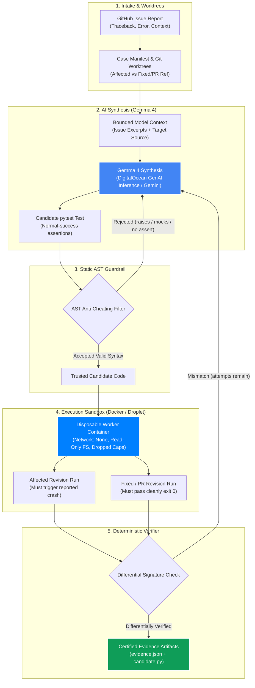

# ReproForge

ReproForge is an autonomous AI bug reproduction system for Python repositories. It takes a crash report, uses Gemma to synthesize a minimal `pytest` reproduction test, and deterministically verifies the test inside isolated container sandboxes across affected and fixed revisions.

> **Core Philosophy:** *Gemma proposes candidate tests; deterministic code running in isolated containers decides the verdict.*

---

## Architecture & Workflow



### Technology Highlights
- **Gemma 4 Intelligence:** Supports hosted `gemma-4-31b-it` via **DigitalOcean Serverless GenAI Inference** (`https://inference.do-ai.run/v1`) or the Google Gemini API. Gemma reads the issue traceback and target code to synthesize minimal pytest tests without cheating.
- **AST Anti-Cheating Engine:** Inspects the candidate's Abstract Syntax Tree before execution. Rejects tests that use `pytest.raises` (inverting tests), manual `raise` statements, `monkeypatch`, or `unittest.mock`.
- **DigitalOcean & Container Isolation:** Untrusted AI code is executed in disposable containers with `--network none` (zero internet access), `--read-only` root filesystems, dropped Linux capabilities, and tmpfs `/tmp`. Ready to run on local Docker or deploy to a DigitalOcean Droplet via [`deploy/cloud-init.yaml`](deploy/cloud-init.yaml).

---

## Evaluation Benchmarks & Results

All cases have been executed and **differentially verified** in isolated Docker containers:

| Case ID | Target Repository | Environment | Target Error Signature | Verification Status | Artifacts |
| :--- | :--- | :--- | :--- | :---: | :---: |
| **HTTPX #3771** | `encode/httpx`<br>*(Active Unmerged PR)* | Python 3.13<br>`reproforge-worker:httpx` | `IndexError: string index out of range`<br>in `httpx/_utils.py:unquote` | **Verified in Docker**<br>(PR commit `55ead904`) | [`evidence.json`](artifacts/encode-httpx-3771/evidence.json)<br>[`candidate.py`](artifacts/encode-httpx-3771/candidate.py) |
| **Click #3449** | `pallets/click`<br>(8.4.0 vs `4df304c`) | Python 3.13<br>`reproforge-worker:py313` | `ValueError: I/O operation on closed file.`<br>in `src/click/testing.py:invoke` | **Verified in Docker**<br>(Attempt 1 model candidate) | [`evidence.json`](artifacts/pallets-click-3449/evidence.json)<br>[`candidate.py`](artifacts/pallets-click-3449/candidate.py) |
| **Click #2865** | `pallets/click`<br>(8.1.7 vs 8.3.3) | Python 3.13<br>`reproforge-worker:py313` | `io.UnsupportedOperation: fileno`<br>in `src/click/core.py:invoke` | **Verified in Docker**<br>(Attempt 1 model candidate) | [`evidence.json`](artifacts/pallets-click-2865/evidence.json)<br>[`candidate.py`](artifacts/pallets-click-2865/candidate.py) |
| **Jinja #1362** | `pallets/jinja`<br>(2.11.3 vs `59de6fb`) | Python 3.8 + MarkupSafe 1.1.1<br>`reproforge-worker:py38` | `TypeError: sequence item 0: expected str...`<br>in `src/jinja2/asyncsupport.py` | **Verified in Docker**<br>(Legacy environment pinning) | [`evidence.json`](artifacts/pallets-jinja-1362/evidence.json)<br>[`candidate.py`](artifacts/pallets-jinja-1362/candidate.py) |

> **Boundary Study:** [`check_markupsafe.py`](check_markupsafe.py) tests MarkupSafe #472 and demonstrates ReproForge's strict guardrail: crashes occurring inside compiled C speedups lacking repository Python stack frames are safely rejected.

---

## Getting Started: 4 Scenarios on How to Run

### Initial Setup (Common to All Scenarios)
```bash
git clone https://github.com/Rigur-Calypso/reproforge.git && cd reproforge
python3 -m venv .venv && source .venv/bin/activate && pip install -e '.[dev]'
pytest tests/ -v   # runs the 20-test AST verifier integrity suite
```

---

### Scenario 1: Evaluators & Judges (Instant Docker Verification — No API Keys Needed)
Verify the real-world HTTPX unmerged Pull Request bug in an isolated container without any API keys:
```bash
# Build the target worker image
docker build -t reproforge-worker:httpx -f worker/Dockerfile.httpx worker

# Run deterministic differential verification in Docker
reproforge run \
  --case evals/cases/httpx-3771.json \
  --candidate artifacts/encode-httpx-3771/candidate.py \
  --backend docker
```
> **What happens:** ReproForge fetches `encode/httpx`, pulls unmerged PR branch `pull/3771/head`, triggers `IndexError` in the container sandbox on `master`, and confirms it passes cleanly on the PR branch (`differentially_verified`).

---

### Scenario 2: Live AI Test Synthesis (Gemma / Gemini)
Have Gemma read a crash manifest and synthesize a brand-new test from scratch:
```bash
# Using Google Gemini API:
GEMINI_API_KEY=your_key reproforge run --case evals/cases/click-3449.json --backend docker

# Using DigitalOcean Serverless GenAI Inference (Gemma 4):
DO_INFERENCE_API_KEY=your_key reproforge run --case evals/cases/click-3449.json --model-backend digitalocean --backend docker
```
> **What happens:** The model reads the traceback and source code, writes a minimal `pytest` test asserting correct behavior, AST anti-cheating validates the code, and Docker executes differential verification.

---

### Scenario 3: Open-Source Maintainers (Triaging Your Own Repository Issue)
To triage an incoming bug report in your own Python library:
1. Create a simple JSON manifest (`my_issue.json`):
```json
{
  "case_id": "my-library-issue-101",
  "repository_url": "https://github.com/my-org/my-repo.git",
  "issue_text": "Calling parse_data('') raises ValueError: empty buffer",
  "expected_exception": "ValueError",
  "affected_ref": "v1.2.0",
  "fixed_ref": "main"
}
```
2. Run ReproForge to generate and verify the reproduction:
```bash
GEMINI_API_KEY=your_key reproforge run --case my_issue.json --backend docker
```
3. **The Result:** ReproForge outputs `artifacts/my-library-issue-101/candidate.py`. You can commit this file directly into your repository's `tests/` folder as a permanent regression test.

---

### Scenario 4: Remote Teams & CI/CD Automation (Cloud Server & HTTP API)
Run ReproForge headlessly on a cloud server or DigitalOcean Droplet so team members can triage bugs over HTTP without needing Docker on their laptops:
```bash
# Launch the background server
reproforge serve --host 0.0.0.0 --port 8080
```
Trigger remote container reproductions from any terminal or webhook:
```bash
curl -X POST http://<SERVER_IP>:8080/run \
  -H "Content-Type: application/json" \
  -d '{"case_id": "encode-httpx-3771", "candidate": "artifacts/encode-httpx-3771/candidate.py", "backend": "docker"}'
```
> **1-Click Cloud Deployment:** When launching an Ubuntu Droplet on DigitalOcean, paste [`deploy/cloud-init.yaml`](deploy/cloud-init.yaml) into **User Data** (or run [`deploy/setup_server.sh`](deploy/setup_server.sh) on any server).

---

## License

ReproForge source is MIT licensed. Model, API, and dependency terms remain governed by their respective providers.
