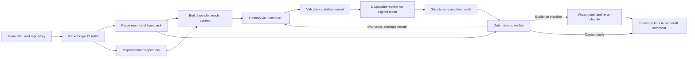

# ReproForge Design

## Purpose

ReproForge takes a Python crash report and attempts to produce a runnable test that reproduces it. It reads a public issue and a pinned repository revision, asks Gemma to propose a test, executes that test in a disposable worker, and checks the observed traceback against evidence in the report.

**Gemma proposes. ReproForge's runner and verifier decide.** A model response saying “this reproduces the bug” is never evidence of success.

This repository now contains an early CLI implementation and one curated Click fail-to-pass case. The model path and Docker worker are implemented; the cloud deployment and broad benchmark are not complete. The implementation and this design document describe a hackathon prototype, not a production sandbox. The Click baseline is issue #3449, affected release 8.4.0, and merged fix commit `4df304c658666f34a5ca4335ab0da15832f02f9e`.

## MVP boundaries

The first working slice supports:

- Public Python repositories and public GitHub issues, or pasted issue text with a repository URL.
- Crash reports with a traceback and enough context to identify a target package and version.
- One Python version and a small number of prebuilt, pinned demo environments.
- A maximum of three model-generated attempts.
- Local Docker for development, with the same worker image deployed to a single DigitalOcean Droplet for the cloud demo.
- A generated `pytest` artifact and machine-readable evidence report.

The MVP does not support arbitrary languages or environments, private code, credentials, network-dependent tests, intermittent bugs, non-crash correctness bugs, auto-posting to GitHub, or production use as a hostile-code sandbox. DOKS, a polished web app, minimization, an agent skill, and broad benchmarking are later work.

## Architecture



### Components

| Component | Responsibility |
|---|---|
| CLI or thin web form | Collect issue/repository inputs and display progress and artifacts. The first implementation should be CLI-first. |
| Orchestrator | Pin run inputs, call the model, dispatch attempts, apply retry limits, and assemble results. |
| Issue parser | Extract exception, message, stack frames, version clues, inputs, and provenance for each clue. |
| Repository inspector | Checkout an immutable commit, identify package/test configuration, and select relevant source context. |
| Gemma adapter | Request structured candidate tests using the Gemini API. |
| Worker | Run one candidate in a disposable, resource-limited environment and return structured output. |
| Verifier | Apply hard provenance and failure-signature rules. It does not use model confidence. |
| Artifact writer | Save the final test, evidence JSON, and a draft comment for human review. |

## End-to-end reproduction procedure

### 1. Receive and pin the issue

The current CLI accepts a reviewed JSON case manifest containing the issue evidence, repository URL, and target refs. It clones the public repository and creates detached checkouts for the exact affected and fixed revisions. Every attempt uses those same commits so a moving branch cannot change the target mid-run. Automatic fetching and parsing of arbitrary GitHub issues is future work; do not describe this prototype as accepting any issue URL directly.

If the issue belongs to a different repository than the supplied URL, or the target version is ambiguous, stop and ask the user to select the right target. Do not silently choose a version based only on the model's guess.

### 2. Extract reported evidence

The parser extracts only claims supported by the issue or traceback. Example:

```json
{
  "expected_exception": "TypeError",
  "message_pattern": "expected.*list",
  "reported_frames": ["parser.py:parse_config"],
  "reported_python": "3.11",
  "reported_package_version": "1.4.2",
  "input_clues": ["configuration contains an empty list"],
  "provenance": {
    "expected_exception": "traceback",
    "input_clues": "issue body"
  }
}
```

The parser assigns readiness:

- **Ready:** a concrete exception/traceback and enough input or call information to attempt the report.
- **Limited:** some evidence exists, but reliable matching may not be possible.
- **Insufficient:** there is no concrete failure condition to check.

When evidence is insufficient, ReproForge stops or requests missing information. It must not invent a signature and then treat that invention as proof.

### 3. Prepare a known repository environment

For the MVP, support only selected repositories with known setup steps. Prebuild one runner image and pin dependency versions. Do not execute arbitrary repository install scripts during a run. For differential checking, mount two detached `git worktree` checkouts (affected SHA and fix SHA) into separate containers using that same image. Select commit pairs only when their test dependencies did not change; otherwise report the comparison as setup-invalid, not fail-to-pass evidence. The execution phase runs with networking disabled.

Record the repository commit, runner image digest, Python version, dependency lockfile hash, and setup recipe. If a supported image cannot be prepared, return **Setup failed**; do not spend model retries on environment failures.

### 4. Select relevant code and form context

Use traceback paths and function names, issue terms, package metadata, and neighboring tests to select a small set of files. Include the source excerpts and paths in the model request. Do not send the whole repository by default.

Issue text, source comments, README files, and test data are untrusted content. The prompt tells Gemma to analyze them as data, not obey instructions embedded inside them. The runner policy is enforced outside the model.

### 5. Ask Gemma for one candidate

Gemma receives the extracted issue evidence, selected code, existing test style, and target environment. It returns structured data containing a short rationale and Python test source. Its predicted exception signature is logged as a hypothesis only.

Before execution, validate the schema, size, filename, and syntax. Reject candidates that try to write into the package, alter the target code, monkeypatch the target, or directly manufacture the expected exception. Static checks catch common attempts; they are not the security boundary. The runtime provenance rule below remains mandatory.

### 6. Execute the candidate

The orchestrator passes a pinned source snapshot, candidate test, runner image, and limits to a fresh worker. During development this worker runs in local Docker. The hackathon cloud demo deploys the same worker service on a DigitalOcean Droplet. The worker returns JSON such as:

```json
{
  "exit_code": 1,
  "timed_out": false,
  "exception_type": "TypeError",
  "exception_message": "...",
  "traceback_frames": [
    {"path": "repro.py", "function": "test_reproduction"},
    {"path": "package/parser.py", "function": "parse_config"}
  ],
  "duration_ms": 124,
  "stdout": "",
  "stderr": "..."
}
```

The worker has no GitHub token, DigitalOcean token, Gemini key, or other secret. It cannot make network requests. Output, time, memory, CPU, and process count are bounded.

### 7. Apply hard verification rules

Do not use a weighted score to decide “Verified.” A candidate is verified against a traceback-based report only when all applicable hard checks pass:

1. The run fails as a Python exception. Syntax errors, import errors, timeouts, and setup failures do not count.
2. The exception class matches the class in the report, when one is reported.
3. The deepest repo-owned traceback frame (ignoring generated test and harness frames) is inside the target package. Dependency frames may appear deeper on the stack.
4. Every report-derived signal that is available must match: if the report provides a message pattern, it must match; if it provides a function, the deepest repo-owned frame must name that function. Neither signal substitutes for the other when both are reported.
5. The exact candidate fails as a test on the affected SHA and passes on the fix SHA.

Normalize unstable details such as temporary paths, line numbers where appropriate, memory addresses, and runner wrapper frames. Preserve the raw trace alongside its normalized form. If the issue has no traceback, the result cannot be **Verified** under this MVP's crash-verification rules; return **Candidate** or **Insufficient evidence**.

The repository-frame rule blocks the simple false positive where generated code just says `raise TypeError(...)`. Candidate code is also checked for direct raises and common monkeypatching patterns, and the package checkout is read-only during execution. These controls reduce easy spoofing; they do not prove that adversarial Python code cannot fake provenance. The static validator also rejects `pytest.raises` for the reported exception: the test must assert normal successful behavior, so it is red on the affected revision and green on the fix.

### 8. Retry with bounded feedback

If the candidate does not match and the attempt limit remains, return the actual structured error to Gemma with a concise reason: wrong exception, wrong package frame, setup error, syntax error, or timeout. Keep the issue signature, commit, environment, and verifier rules fixed. Stop after three attempts and stop early on duplicate candidates.

The model cannot modify verifier rules, worker limits, selected commit, or credentials. If all retries fail, return **Not reproduced** or **Setup failed** with the evidence.

### 9. Create and validate the final test

Ask Gemma for a `pytest` test from the start; do not use a script-then-convert model call. Validate and run that exact test on both revisions. The test must call the target code and assert ordinary correct behavior, not assert that the reported exception is raised. Do not claim differential verification unless the affected run fails with the matched signature and the fixed run passes.

Minimization is deferred. If added later, use delta debugging: remove or simplify one element, rerun the exact verifier, and retain the change only if the required failure remains. Never modify project source as part of minimization.

### 10. Produce artifacts for human review

Save:

- Generated pytest test and exact local command.
- Raw and normalized output for every attempt.
- Issue signature and observed signature, with matched evidence highlighted.
- Repository URL and commit SHA, Python version, image digest, and dependency hash.
- Attempt history, duration, resource limits, and final status.
- Optional draft issue comment.

ReproForge does not publish comments, commits, or pull requests automatically.

## Result statuses

| Status | Meaning |
|---|---|
| **Verified** | Hard checks match issue evidence and the final test repeats in clean runs. |
| **Differentially verified** | The final test fails on the affected commit and passes on a known fixed commit. This is the strongest result. |
| **Candidate** | A plausible failure occurred, but report evidence is incomplete or a required hard check cannot be satisfied. |
| **Not reproduced** | The supported environment ran, but no matching failure was obtained within the retry limit. |
| **Setup failed** | The target environment could not be prepared or execution failed before reaching the tested code. |
| **Insufficient evidence** | The issue does not provide a concrete failure condition to verify. |

For evaluation, prefer issues that were later fixed. Run the same generated test on both the affected commit and the fix commit: it should fail on the former and pass on the latter. This is an objective fail-to-pass signal. If no fix commit exists, report the result as traceback-matched, not differential. A 1–5 case sample is an early demo evaluation, not a general reliability claim; always report raw counts and false verified outcomes.

## DigitalOcean deployment

DigitalOcean has a direct role: the remote worker runs each model-written reproduction against a pinned public repository and returns the observations used by the verifier. This is part of ReproForge's execution and evidence path, not just a static website deployment.

To fit hackathon time, develop the worker locally in Docker first, then deploy the same worker service to one DigitalOcean Droplet for the cloud demo. Keep the worker isolated from the API and run one job per fresh container. Defer DOKS because Kubernetes adds setup and operational work without improving the first demo's core claim. CPU resources are adequate for the selected Python crash cases; GPU compute is not needed for test execution. If cloud deployment is blocked, label it incomplete and show the local Docker run; do not imply the remote path is live.

Gemma generation uses the Gemini API for direct alignment with the Gemma challenge description. DigitalOcean's current model catalog also lists a Gemma 4 endpoint (`gemma-4-31B-it`) as an alternate inference route, but this is not required by the MVP and should be used for the Gemma track only if organizers confirm it fits their judging expectations. [DigitalOcean supported models](https://docs.digitalocean.com/products/inference/details/models/)

The Droplet/container setup is a hackathon prototype, not a hardened hostile-code sandbox. Do not run it as a public multi-tenant service. Restrict access to the demo, use disposable containers, keep all API credentials outside workers, and shut the demo down after judging.

## Worker isolation policy

The MVP worker should use:

- Disposable Docker container per attempt; no host filesystem or Docker socket mount.
- Non-root user, read-only root filesystem, read-only checked-out source, and bounded temporary storage.
- `--network none`, dropped Linux capabilities, seccomp profile, memory/CPU/process/time limits, and bounded logs.
- No cloud, GitHub, or model credentials in the container.
- Pinned runner image and source revision in the evidence record.
- Cleanup after every attempt.

The repository is untrusted too. Only use curated public repos with prebuilt environments. Do not run arbitrary dependency installation scripts or untrusted post-install hooks as part of the reproduction job. These measures lower risk; they are not a substitute for a security-reviewed sandbox.

## Gemma and open-source track fit

Gemma reads the issue and relevant code, proposes a test, and revises it based on real execution output. This is the part to show in the demo. ReproForge adds original harness behavior: bounded orchestration, execution, provenance checks, fail-to-pass evaluation, and evidence artifacts.

Publish the project in a public GitHub repository with an open-source license and a README that identifies the model, key dependencies, and how to run the project. The project license does not grant rights to model weights or external services; review each dependency and model's terms before release. The event describes the open-source category as requiring open-source or open-weight AI to be important, plus a public repository and open-source license. [Best Open-Source AI Project](https://www.mlh.com/events/hacktoberfest-hack-day-zuarinagar-x-seds-celestia/challenges/01a0d987-0c41-12ea-13ac-5b85755dc2f3)

An agent skill is an alternative submission form, not a required feature for this application. Do not add a `SKILL.md` during the MVP; it would add another standard to implement without strengthening the core demo.

## Hackathon build order

Prioritize a working narrow loop:

1. Pick one small public Python repository, one issue with a traceback, and—if available—the fixing commit. Time-box issue selection to 30 minutes; prefer a closed issue with a linked fix, few dependencies, and a real traceback.
2. Build one preconfigured Docker image for that repository; ensure no network access during reproduction.
3. Implement the worker that runs a supplied candidate and returns structured JSON.
4. Implement traceback parsing and hard verification, including the repository-frame requirement.
5. Connect Gemma, generate up to three candidates, and feed real worker output back between attempts.
6. Save a `pytest` artifact and evidence JSON, then rerun the final test cleanly.
7. Deploy the same worker container to one DigitalOcean Droplet and demonstrate a run there. If cloud deployment is blocked, label it incomplete and show the local Docker run; do not imply the remote path is live.
8. Add a thin UI only after the full path works from the command line.

The live demo should use a curated issue with clear evidence, not an arbitrary issue selected on stage. A strong demo shows one failed attempt, the feedback loop, a repository-frame match, and the final test. Do not stage fabricated evaluation results or imply that a one-case demo proves general reliability.

## Evaluation plan

Start with one known issue/fix pair, then add cases only as time allows. Each case records:

- Issue URL, repository, affected commit, fixing commit if available.
- Expected exception and relevant package frames.
- Python version and pinned environment.
- Human-reviewed reference reproduction.
- ReproForge result and whether the test has a fail-to-pass outcome.

Report counts plainly, for example: “Differentially reproduced 2 of 3 curated issues; one setup failure; zero false verified results in this set.” Do not generalize from a tiny benchmark. Track false verified results as the highest priority metric; if one occurs, fix the verifier before making a verification claim.

## Implemented source layout and planned modules

```text
reproforge/
├── reproforge/
│   ├── __init__.py           # Package marker
│   ├── cli.py               # CLI orchestration, worktrees, retries, and evidence
│   ├── gemini.py            # Gemini and DigitalOcean model adapters
│   ├── runner.py            # Docker execution and host-unsafe runner
│   ├── verifier.py          # AST anti-cheating validator and differential verifier
│   ├── [planned] issue.py   # Future: automatic GitHub issue scraper
│   └── [planned] repo.py    # Future: automatic repository inspector
├── worker/
│   ├── Dockerfile           # Minimal pinned worker container
│   └── pytest_plugin.py     # Custom telemetry plugin for structured exceptions
├── tests/
│   └── test_verifier.py     # 20 unit tests for AST safeguards and signature logic
├── evals/
│   ├── cases/               # Curated JSON evaluation manifests
│   └── reproductions/       # Baseline reference reproductions
├── artifacts/               # Generated candidate tests and evidence reports
├── docs/design.md           # Architecture design
├── README.md
└── LICENSE
```

The core implemented files are `reproforge/cli.py`, `reproforge/gemini.py`, `reproforge/runner.py`, `reproforge/verifier.py`, `worker/pytest_plugin.py`, `worker/Dockerfile`, and `tests/test_verifier.py`. Automatic scraping of arbitrary GitHub issues, dynamic repository context indexing, and live Droplet hosting remain future work.
